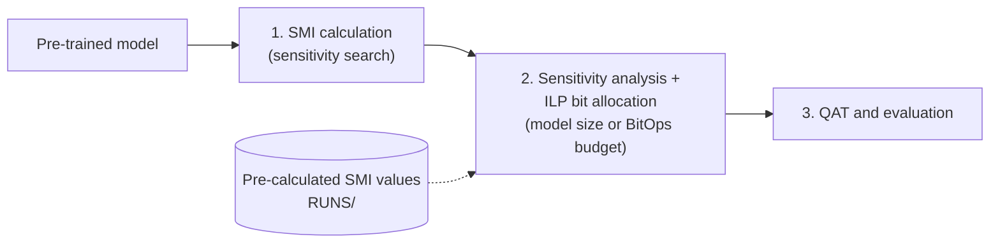
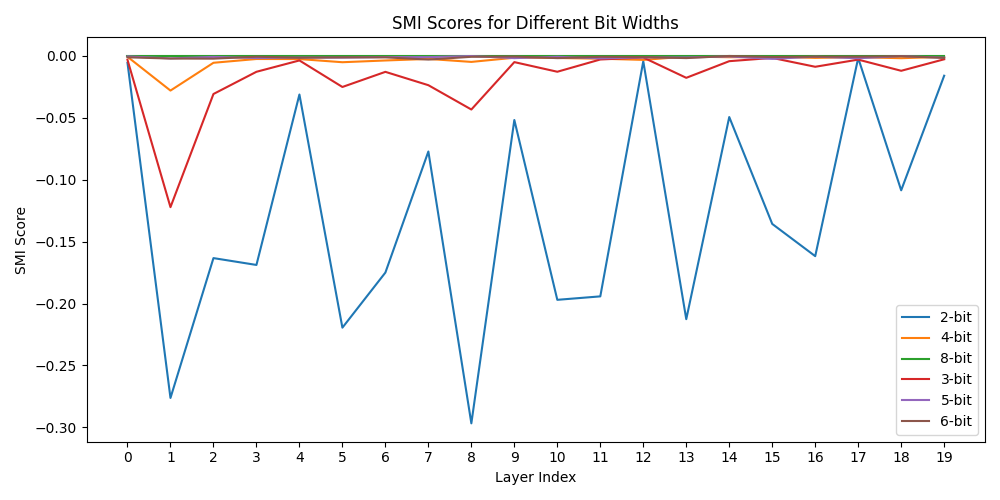

<div align="center">

# InfoQ: Mixed-Precision Quantization via Global Information Flow

[](https://github.com/mehmetemreakbulut/InfoQ/stargazers)
[](https://github.com/mehmetemreakbulut/InfoQ/network/members)
[](https://github.com/mehmetemreakbulut/InfoQ/watchers)

[](https://www.python.org/)
[](https://pytorch.org/)
[](https://rapids.ai/)
[](https://huggingface.co/datasets)
[-2a78d6)](https://coin-or.github.io/pulp/)
[](https://github.com/mehmetemreakbulut/InfoQ/commits)
[](https://github.com/mehmetemreakbulut/InfoQ/issues)


[Abstract](#abstract) •
[Methodology](#methodology) •
[Setup](#setup) •
[SMI calculation](#smi-calculation) •
[ILP Search](#ilp-based-bit-width-search) •
[QAT and Evaluation](#qat-and-evaluation)

</div>

---

## ✨ Highlights

| | |
|---|---|
| 🌐 **Global sensitivity** | Measures how quantizing one layer changes the mutual information in the *remaining* part of the network |
| ⚡ **Training-free search** | A single forward pass measures the change in mutual information, no training in the bit-width search phase |
| 🧮 **ILP bit allocation** | Minimizes total sensitivity under a model-size or BitOps budget, solved instantly |
| 📉 **Data efficient** | Two orders of magnitude less data than LIMPQ |
| 🎯 **Accuracy** | Up to **+1%** on ImageNet for MobileNetV2 (**14.00×**) and ResNet18 (**10.66×**) |

## Abstract

Mixed-precision quantization (MPQ) is crucial for deploying deep neural networks on resource-constrained devices, but finding the optimal bit-width for each layer represents a complex combinatorial optimization problem. Current state-of-the-art methods rely on computationally expensive search algorithms or local sensitivity heuristic proxies like the Hessian, which fail to capture the cascading global effects of quantization error. In this work, we argue that the quantization sensitivity of a layer should not be measured by its local properties but by its impact on the information flow throughout the entire network. We introduce InfoQ, a novel framework for mixed-precision quantization that is training-free in the bit-width search phase. InfoQ assesses layer importance by performing a single forward pass to measure the change in mutual information in the remaining part of the network, thus creating a global sensitivity score. This approach directly quantifies how quantizing one layer degrades the information characteristics of subsequent layers. The resulting scores are used to formulate bit-width allocation as an integer linear programming problem, which is solved efficiently to minimize total sensitivity under a given budget (e.g., model size or BitOps). Our training-free search phase provides a superior search-time/accuracy trade-off (using two orders of magnitude less data compared to state-of-the-art methods such as LIMPQ), while yielding up to a 1% accuracy improvement for MobileNetV2 and ResNet18 on ImageNet at high compression rates (14.00x and 10.66x).


## Methodology

The InfoQ method consists of three parts:

  - SMI calculation (A relatively long phase of the sensitivity search stage)
  - Sensitivity analysis and bit allocation with respect to a given constraint (Instant)
  - QAT to recover accuracy for comparison with state-of-the-art methods



| Stage | Code | Time |
|---|---|---|
| 1. SMI calculation | `SMI/` | ⏳ relatively long |
| 2. Sensitivity analysis and bit allocation | `SMI_score/` | ⚡ instant |
| 3. QAT and evaluation | `SMI_FINAL/quantization_training/` | 🏋️ training |

<details>
<summary>📁 <b>Repository structure</b></summary>

```text
InfoQ/
├── SMI/                       # SMI calculation (smi_calculation.py, smi_calculation_ACT.py)
│   └── configs/               # .yaml configs per model
├── SMI_score/                 # Sensitivity scores and ILP solvers (ilp_solver_weight_only.py, constraints.py)
├── SMI_FINAL/
│   └── quantization_training/ # QAT and evaluation (main.py and .yaml files per experiment)
├── RUNS/                      # Pre-calculated SMI values (weights per model, activations in RUNS/ACT)
├── models/                    # Model definitions
├── mqbench/                   # MQBench (fake quantization)
├── mqbench_quantization/      # Mixed-precision quantization helpers on top of MQBench
├── setup.sh
└── requirements.txt
```

</details>

## Setup

1. Run ```sh setup.sh```. This will install libraries needed.
2. If you run the code in a low disk space instance, you can face some problems during quantization-aware training because this code uses ImageNet dataset through the huggingface library. Moreover, you can wait a little when downloading the dataset in the start of the process.

## SMI calculation

Firstly, you can calculate Sliced Mutual Information (SMI) values on the observer blocks to retrieve the sensitivity metric, or you can use the pre-calculated SMI values in the `RUNS` folder. SMI calculations for activation sensitivity analysis are in the `RUNS/ACT` folder, whereas weight sensitivities are stored in each model's folder.
To calculate the SMI values needed for bit-widths {2,3,4,5,6,7,8}:

```bash
python3 -m SMI.smi_calculation --config resnet18_imagenet.yaml
python3 -m SMI.smi_calculation --config resnet50_imagenet.yaml
python3 -m SMI.smi_calculation_ACT --config resnet18_imagenet.yaml
```

Change the config file if fewer bit-widths are needed.

> [!NOTE]
> The paper results were produced with the original implementation, which `reproduce: true` (set in the provided configs) reproduces. The released code now fixes two issues in the MI(X;L) estimation: the DINOv2 input was rescaled twice, and only L was sliced. These are not crucial issues but current we have better MI estimation. In the paper configs, MI(X;L) contributes only a small part of the sensitivity score. In addition, the observer layer selection is designed to make the sensitivity score robust to such problems in the MI estimation. We have not re-run the full experiments with the fixed estimator. To use the fixed estimator, remove `reproduce: true` from the config. Thanks to [Florian Idrizi](https://github.com/MrIdrizi) for reporting these issues. I am not working on this topic, please reach me if these changes make the algorithm better. Or if you find some Information Bottleneck related insights about MPQ afte these fixes, please contact me. I am still curious.

<details>
<summary>📈 <b>Example: per-layer SMI scores for ResNet18 (pre-calculated)</b></summary>

<p align="center">
  
</p>

</details>

## ILP-Based Bit-Width Search

Secondly, an ILP-based bit-width search is conducted via the solver. You can directly use the pre-calculated SMI values. For weight-only experiments (ResNet18 and MobileNetV2):

```bash
python3 -m SMI_score.ilp_solver_weight_only --modelname resnet18_gluon --compression 10.66

python3 -m SMI_score.ilp_solver_weight_only --modelname mobilenetv2 --compression 14.00 --last_layer_bw 2
```

Note: For `mobilenetv2`, 2 is selected for the last layer's bit-width to satisfy 14.00x compression.

The other two experiments for ResNet18 and ResNet50 also require the activation sensitivities. Assuming that you already have them (or you can use the pre-calculated values), the ILP solver is used again to find the bit-widths.

```bash
python3 -m SMI_score.constraints --model resnet50_gluon --b 6 5 4 3 2 --wb 3 --ab 4 --bops True --alpha 2 --cr 12.2
python3 -m SMI_score.constraints --model resnet18_gluon --b 6 5 4 3 2 --wb 3 --ab 3 --bops True --alpha 0.1
```

| Model | Setting | Constraint |
|---|---|---|
| ResNet18 | weight-only | 10.66× compression |
| MobileNetV2 | weight-only (last layer 2 bit) | 14.00× compression |
| ResNet50 | weights + activations | W3A4 BitOps, 12.2× compression |
| ResNet18 | weights + activations | W3A3 BitOps |

A possible output for ResNet50:

| 📦 FP model size | 📦 Searched model size | 🗜️ Compression | ⚙️ Searched / target BitOps |
|:---:|:---:|:---:|:---:|
| 97.286 MB | 7.973 MB | 12.20× | 0.998 |

```text
compress radio 12.201416159528458
FP model size (MB) 97.286 searched model size (MB) 7.973
********************************************************************************
7.620329472 extra bitops for first layer
bitops radio (fp_bitops/target_bitops) 73.717 bitops radio (searched_bitops/target_bitops) 0.998 searched bitops 55.946 target bitops 56.036
********************************************************************************
searched weight bit-widths [6, 5, 5, 6, 3, 4, 4, 4, 4, 4, 4, 3, 4, 3, 4, 4, 3, 3, 3, 3, 4, 3, 3, 3, 2, 3, 2, 3, 2, 2, 3, 2, 2, 3, 2, 2, 3, 2, 2, 2, 2, 2, 2, 2, 2, 2, 2, 2, 2, 2, 2, 2]
searched act bit-widths [6, 4, 5, 6, 6, 4, 4, 5, 3, 4, 4, 4, 6, 4, 3, 4, 4, 4, 5, 4, 4, 2, 3, 3, 4, 5, 5, 6, 2, 5, 4, 3, 3, 4, 5, 5, 5, 4, 5, 5, 4, 4, 6, 3, 4, 4, 5, 5, 6, 6, 6, 5]
```

## QAT and Evaluation

For each experiment, there is a `.yaml` file in the `SMI_FINAL` folder. You can use the bit-widths to modify the `.yaml` file for Quantization-Aware Training. In the `SMI_FINAL/quantization_training` folder, you can start the training via:

```bash
torchrun --nproc_per_node={NUM_GPUs} main.py finetune_resnet50.yaml
```

  - Note: For MobileNetV2, please change line 50 in `SMI_FINAL/quantization_training/quan/utils.py` to set the FC layer to 2 bits.
  - Note: For training, you can resume a finished run to iterate for a few more epochs to get better accuracy (e.g., `lr=1e-7`). You can find all the configurations in the folder. After training, you can set `eval=True` in the `.yaml` file to evaluate the model.

---

<div align="center">

### ⭐ Star History

[](https://star-history.com/#mehmetemreakbulut/InfoQ&Date)

If you find InfoQ useful, please consider giving it a ⭐

</div>
